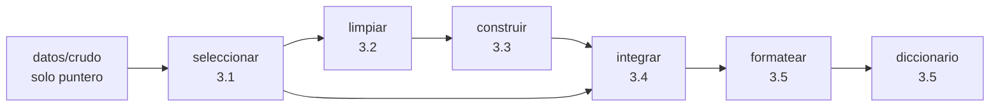

# Fit Vision · Etapa 3 de CRISP-DM · Preparación de datos con DVC

Proyecto Integrador I · UTEC Posgrado · Evaluación continua
**Integrantes:** _[completar nombres del equipo]_

Fit Vision clasifica la **calidad de ejecución de una repetición** de ejercicio (*bien* / *mal*) a
partir de señales de pose (MediaPipe), para dar retroalimentación objetiva al fisioterapeuta en
rehabilitación. Este repositorio contiene la **etapa 3 (preparación de datos)** como un pipeline
reproducible y auditable: la tabla de modelado se obtiene ejecutando un programa, y cada decisión
queda escrita con su motivo.

> ### ⚠️ Procedencia de los datos de esta entrega
> El crudo versionado en `datos/crudo` es **sintético** (`manifest.json → origen: sintetico_demo`).
> Reproduce solo lo verificado del dataset real en la etapa 2 (19 clips: base 1 / bien 8 / mal 10;
> 164 frames; 4 señales; 4 videos etiquetados y 2 sin etiquetar), generado con semilla fija por
> `tools/generar_crudo_sintetico.py`. **No es el dataset de la clínica** y sus números no deben leerse
> como resultados del proyecto. Para pasar al dataset real, ver *«Cambiar al dataset real»*.

## Cómo reproducirlo (clon nuevo)

```bash
conda env create -f environment.yml && conda activate fitvision-e3   # incluye el conector dvc-s3
git clone <URL-del-repositorio> && cd <carpeta>
dvc pull                                  # recupera datos/crudo por su huella
dvc repro                                 # reconstruye todo; "todo al día" si nada cambió
python tools/verificar_criterios.py       # los 7 criterios de aceptación
```

Sin remoto operativo (p. ej. al evaluar el ZIP): el ZIP incluye la caché local de DVC, así que
`dvc checkout` recupera `datos/crudo` sin red y `dvc repro --force` reconstruye todo (verificado:
`dvc.lock` queda idéntico). Requiere el conector `dvc-s3` instalado aunque no se use la red.

## El pipeline (`dvc.yaml`)



| Tarea CRISP-DM | Etapa DVC | Código | Parámetros (`params.yaml`) | Decisión (bitácora) | Salida documental |
|---|---|---|---|---|---|
| 3.1 Seleccionar | `seleccionar` | `src/seleccionar.py` | `seleccion`, `columnas` | [0002](docs/decisiones/0002-alcance-filas.md), [0003](docs/decisiones/0003-fuentes-excluidas.md) | `reportes/seleccion.json` |
| 3.2 Limpiar | `limpiar` | `src/limpiar.py` | `limpieza` | [0004](docs/decisiones/0004-limpieza-senales.md) | `reportes/limpieza.json`, `reportes/informe_limpieza.md` |
| 3.3 Construir | `construir` | `src/construir.py` | `construccion` | [0005](docs/decisiones/0005-construccion-features.md) | `datos/intermedio/construido.parquet` |
| 3.4 Integrar | `integrar` | `src/integrar.py` | `columnas` | [0006](docs/decisiones/0006-integracion-y-particion.md) | `datos/intermedio/integrado.parquet` |
| 3.5 Dar formato | `formatear`, `diccionario` | `src/formatear.py`, `src/diccionario.py` | `particion`, `formato` | [0007](docs/decisiones/0007-formato-y-diccionario.md) | `datos/final/tabla_modelado.*`, `docs/diccionario/diccionario.csv`, `reportes/tabla_final.json` |

Este mapeo es una propuesta del curso: CRISP-DM no menciona el control de versiones ni obliga a
cinco etapas ni a un orden. La iteración que describe el estándar vive en el **historial de Git**:
cada vuelta atrás es una versión más de la receta.

## Resumen de lo que hace el pipeline

| Paso | Entrada → salida (con el crudo de demostración) |
|---|---|
| Seleccionar | 19 → **18 clips** (sale `base`, 1 clip < mínimo 2); 164 → 156 frames |
| Limpiar | 156 → **137 frames** (19 frames congelados eliminados, 12.2 %); 0 faltantes; 0 fuera de rango |
| Construir | 1 fila por clip: media y desviación de 4 señales = **8 features** + `n_frames` |
| Integrar | unión 1:1 con etiqueta y video (falla si cambia el nº de clips) |
| Formatear | tabla de **18 × 14**, `y` (bien = 1, mal = 0), `fold` por `GroupKFold` agrupando por video; baseline mayoritario 0.5556 |

Advertencia que el pipeline deja a la vista: el video 211856 concentra 11 de 18 clips (61 %), así
que un fold contiene el 61 % de las filas. Con tan pocos videos las métricas por fold serán ruidosas
(decisión 0006). Imputación y escalado **no** se hacen aquí: se ajustarán dentro de cada fold en
modelado, para que la prueba nunca influya en la preparación.

## Estructura del repositorio

```
├── README.md                      <- esta portada
├── dvc.yaml                       <- la receta (escrita a mano, versionada)
├── dvc.lock                       <- la anotación (la genera DVC; se versiona, no se edita)
├── params.yaml                    <- todas las decisiones numéricas / listas, en claro
├── environment.yml · requirements.txt   <- con qué se ejecuta (versiones fijadas)
├── datos/
│   ├── crudo.dvc                  <- puntero al crudo (inmutable, solo lectura)
│   ├── intermedio/ · final/       <- salidas de etapas (no están en Git)
├── src/                           <- el código de cada tarea (sin constantes de negocio)
├── docs/
│   ├── decisiones/                <- la bitácora: una entrada por decisión (0001…0008)
│   ├── diccionario/               <- descripciones.yaml (humano) → diccionario.csv (generado)
│   └── issues/ISSUES.md           <- asuntos que originan cada decisión
├── reportes/                      <- métricas e informe de limpieza (salidas de etapas)
├── tools/                         <- generador del crudo sintético y verificador de criterios
├── .dvc/config                    <- dónde vive el remoto (las claves van en .dvc/config.local)
└── .github/                       <- CI de reproducibilidad, plantillas de PR y de asunto
```

## La cadena de trazabilidad

`decisión (asunto) → justificación (bitácora) → código → parámetro → salida → resultado`

- El **mensaje de cada commit** cita el asunto (`Refs #N`) y la decisión.
- Cada **entrada de la bitácora** nombra el parámetro y el código que la aplican.
- Cada **etapa** de `dvc.yaml` apunta a su entrada de la bitácora en `desc`.
- `dvc.lock` registra, por etapa, huella del código, de los datos, de los **parámetros** y de la salida.
  Cambiar un valor en `params.yaml` se ve en el diff de `dvc.lock` junto con la tabla que produjo.

## Criterios de aceptación (verificables por un tercero)

`python tools/verificar_criterios.py` ejecuta y muestra el resultado de cada uno:

| # | Criterio | Cómo se comprueba | Estado |
|---|---|---|---|
| 1 | Reproducibilidad | `dvc repro --force` y `dvc.lock` idéntico | ✅ automático |
| 2 | Separación datos/código | ninguna tabla en el historial; crudo solo como puntero | ✅ automático |
| 3 | Cobertura de decisiones | cada etapa cita su entrada; cada entrada, citada por un commit | ✅ automático |
| 4 | Parametrización | sin umbrales/listas en `src/`; todo `params.yaml` anotado en `dvc.lock` | ✅ automático |
| 5 | Diccionario de datos | cubre el 100 % de las columnas y es salida declarada | ✅ automático |
| 6 | Informe de limpieza | salida de `limpiar` con métricas declaradas | ✅ automático |
| 7 | Traza de colaboración | ramas por decisión, PR con asunto, CI | ⚠️ falta **proteger `main` en GitHub** |

## Pendientes antes de publicar (requieren acciones fuera de este ZIP)

1. **Remoto de datos.** `.dvc/config` trae un marcador `s3://REEMPLAZAR-NOMBRE-DEL-BUCKET/...`.
   Crear el depósito (S3 o Cloud Storage; Drive solo con reservas), con permiso mínimo
   (listar, leer, escribir en *ese* depósito), y ejecutar:
   ```bash
   dvc remote modify almacen url s3://MI-BUCKET/fitvision/datos
   dvc remote modify --local almacen access_key_id   '<clave>'      # NO se versiona
   dvc remote modify --local almacen secret_access_key '<secreto>'  # NO se versiona
   git check-ignore .dvc/config.local                               # debe responder la ruta
   dvc push && git push --follow-tags                               # primero contenido, luego historial
   ```
2. **Proteger `main`** (Settings → Branches): revisión obligatoria y comprobación `reproducibilidad`.
3. **Crear los asuntos** de `docs/issues/ISSUES.md` en ese orden para que `#1…#8` coincidan.
4. **Completar integrantes** y la URL del repositorio.

## Cambiar al dataset real

Contrato de entrada de `datos/crudo/`: `clips/<clip_id>.csv` (columnas `frame` y las 4 señales),
`labels.json` (`{clip_id: {etiqueta, video}}`) y `manifest.json` (`{origen, videos: [...]}`).
El export real de `cortador.py` debe convertirse a ese formato (no se tuvo acceso a ese export al
armar esta entrega). Luego:

```bash
dvc add datos/crudo && git add datos/crudo.dvc && git commit -m "datos: crudo real (Refs #1)"
git tag -a datos-v2 -m "crudo real" && dvc repro && git add dvc.lock reportes && git commit -m "..."
```
Los umbrales de `params.yaml → limpieza.limites` son rangos físicos plausibles, **no clínicos**: deben
validarse con la fisioterapeuta.

## Reglas de colaboración

Una rama por decisión (`decision/NNNN-tema`), cambio entra por PR revisado y enlaza su asunto;
`params.yaml` y `dvc.lock` cambian **en el mismo commit**; `dvc push` antes de `git push`; nunca
editar a mano una salida del pipeline (se corrige el código o el parámetro); `datos/crudo` no se modifica.

> Reproducible no significa correcto: versionar no hace bueno el proyecto, lo hace auditable.
